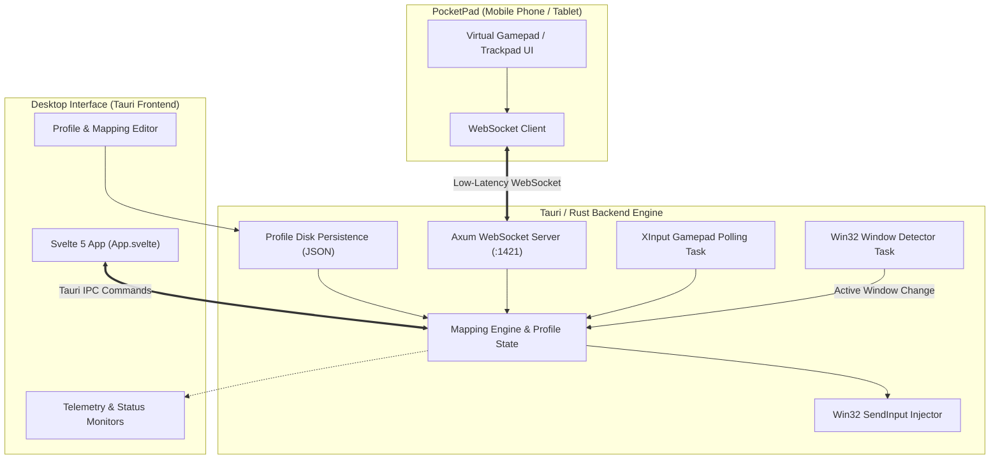

# ControlDeck Architecture & Design Specifications

This document outlines the internal design, concurrency models, and runtime flows of ControlDeck.

---

## 1. High-Level System Layers

ControlDeck integrates a multi-tier pipeline designed for high responsiveness:

---

## 2. Core Modules Breakdown

### 2.1 Backend Modules (`src-tauri/src/`)

- **`controller/`**:
  - `xinput.rs`: Handles polling of connected physical gamepads using `XInputGetState`. Normalizes stick coordinates, deadzones, trigger thresholds, and button bitmasks.
- **`detector/`**:
  - `window.rs`: Runs a background thread querying `GetForegroundWindow` and `GetWindowTextW`. When focus changes, matches rules against profile conditions (executable name, window title) to switch active profiles automatically.
- **`injection/`**:
  - `sendinput.rs`: Translates logical controller actions into virtual keyboard and mouse inputs using the Windows `SendInput` API (`INPUT_MOUSE`, `INPUT_KEYBOARD`).
- **`mapping/`**:
  - `engine.rs`: Core evaluation engine. Maps physical/virtual button states through active profile binding matrices and computes analog-to-mouse acceleration curves.
- **`profile/`**:
  - `schema.rs` & `store.rs`: Serializes profiles, button mappings, sensitivity curves, and auto-activation rules to local JSON storage.
- **`server/`**:
  - `mod.rs`: Houses an Axum HTTP + WebSocket service running on port 1421. Serves the pre-compiled `dist-mobile/index.html` singlefile bundle and accepts real-time touch events from PocketPad clients.

---

## 3. PocketPad Mobile Companion (`src/mobile/`)

PocketPad is bundled into a single standalone HTML artifact using `vite-plugin-singlefile`:
- **Virtual Gamepad**: Dual analog virtual joysticks, directional pads, and action buttons with haptic feedback (`navigator.vibrate`).
- **Virtual Trackpad**: Relative finger movement transformed into smooth PC mouse cursor movement with tap-to-click.
- **Action Deck**: Configurable grid of quick-action macro buttons.

---

## 4. Concurrency & Synchronization Model

- **Tokio Asynchronous Runtime**: The Rust backend utilizes multi-threaded Tokio for non-blocking I/O (WebSocket connections, IPC channels, and timer loops).
- **Zero-Lock Channel Architecture**: Controller poller and mobile input threads stream state diffs across bounded `tokio::sync::mpsc` channels directly to the mapping engine to eliminate lock contention.
